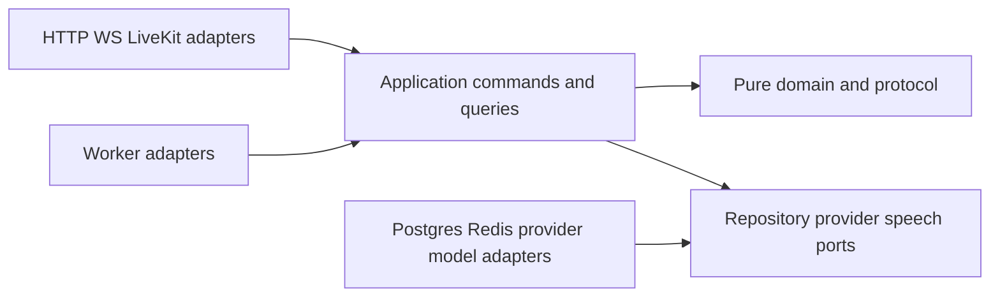

# Backend architecture and execution logic

## 1. Architectural style

Implement a modular monolith with explicit domain boundaries. Run it as three main backend processes—API controller, voice worker, and durable worker—plus the isolated experiment runner. This is enough isolation for media latency, durable recovery, and research repeatability without creating a distributed microservice project that overwhelms an FYP.

### Dependency direction



The domain package contains values, legal transitions, invariants, and decisions. It must remain testable without FastAPI, SQLAlchemy, LiveKit, Redis, or any model SDK.

## 2. Bounded modules

## Identity and session

Responsibilities: issue a short-lived signed demo session; bind `actor_id`, `resident_id`, allowed synthetic property, call ID, and experiment run; generate LiveKit room token.

Non-goal: RBAC/RABAC policy administration.

## Conversation

Responsibilities: call lifecycle; utterance and transcript spans; turn and interruption events; conversation phase; candidate intent provenance; consent and retention flags.

## Intent

Responsibilities: validate model-produced candidate intent; distinguish clarification from acceptance; serialize accepted revisions; classify change (`PARAMETER_CORRECTION`, `REPLACEMENT`, `RETRACTION`, `ADDITIVE_COMPATIBLE`, `CONFLICTING_CHANGE`, `UNRELATED`).

## Workflow

Responsibilities: aggregate the current accepted revision, linked operations, desired final state, unresolved obligations, and resolution status.

## Operations

Responsibilities: stable identity, request hash, state dimensions, attempts, dispatch marker, response handling, leases, retry budget, and causal links.

## Maintenance domain

Responsibilities: residents, properties, units, tickets, appointments, availability, conflict prevention, reschedule/cancel/compensate policy.

## Verification

Responsibilities: query authoritative state; produce `SATISFIED`, `VIOLATED`, or `UNKNOWN`; record evidence items, source version, predicates, freshness, and invalidation.

## Reconciliation

Responsibilities: recover ambiguous effects; choose safe lookup; determine whether old effect exists; preserve, transition, compensate, or escalate according to declared policy.

## Speech policy

Responsibilities: classify proposed speech semantics; authorize progress language; issue claim permits from applicable receipts; render deterministic decisive templates; invalidate stale permits; maintain repair obligations.

## Events and delivery

Responsibilities: append workflow events; transactional outbox; consumer inbox; SSE/WebSocket projection; n8n integration only after verified/resolved events.

## Handoff

Responsibilities: durable unresolved case, known/unknown facts, linked operations and evidence, review deadline, resolution record.

## Research laboratory

Responsibilities: scenario DSL, provider simulator, named barriers, faults, independent oracle, paired execution, frozen manifests, metrics, replay.

## 3. Command/query boundary

### Commands

Commands may mutate state and therefore require server-injected actor identity, validation, idempotency, expected version, a transaction boundary, and emitted events.

- `CreateCall`
- `AcceptIntentRevision`
- `PrepareOperation`
- `CommitLocalAppointment`
- `RecordDispatch`
- `RecordProviderResponse`
- `MarkOutcomeUnknown`
- `RequestVerification`
- `IssueVerificationReceipt`
- `ScheduleReconciliation`
- `PlanCompensation`
- `IssueClaimPermit`
- `RecordAudioSegment`
- `RecordPlaybackEvent`
- `CreateRepairObligation`
- `ResolveRepairObligation`
- `CreateHandoff`
- `StartEvaluationRun`

### Queries

Queries may read replicas or cached projections only if freshness is exposed. Verification queries for correctness must read the authoritative source required by the adapter contract.

## 4. Intent acceptance transaction

The LLM produces a candidate intent with transcript/audio provenance. Deterministic code then:

1. Parses against the versioned Pydantic schema.
2. Injects actor and resident binding from the signed session.
3. Validates resource ownership association and provider host allowlist.
4. Normalizes time using the requested local time and IANA zone.
5. Checks required fields and decides whether clarification is required.
6. Locks the workflow row.
7. Compares `expected_revision` with `current_revision`.
8. Inserts an immutable revision with a monotonically increasing number.
9. Sets `workflow.current_revision` and the new desired final state.
10. Cancels operations that are provably before dispatch.
11. Marks dispatched/in-flight older operations superseded and schedules reconciliation.
12. Invalidates queued/unpublished older claim permits.
13. If stale decisive audio was already acknowledged as played, creates a repair obligation.
14. Appends events and outbox rows.
15. Commits.

No provider call occurs inside this transaction.

## 5. Local commit protocol

For PostgreSQL-owned domain resources, one short transaction must:

1. Lock workflow, operation, and affected resource rows in a consistent order.
2. Confirm current accepted revision equals the operation revision, unless a declared reusable transition applies.
3. Confirm expected resource version.
4. Re-evaluate appointment overlap and domain preconditions.
5. Apply ticket/appointment mutation.
6. Append effect-ledger before/after facts.
7. Update operation dimensions.
8. Insert outbox events.
9. Commit.

If revision 2 commits first, the obsolete revision-1 mutation fails the comparison. If revision 1 commits first, revision 2 must observe the resulting effect and transition it; it cannot pretend it never happened.

## 6. External provider protocol

### Before send

- Create the operation and provider idempotency key once.
- Persist normalized request hash.
- Persist `DISPATCH_RECORDED` and an attempt row.
- Commit before sending.

### Send

- Never hold a database lock.
- Send the same provider idempotency key for retries of the same logical operation.
- Record monotonic send timing and raw request hash.

### Response received

- Persist raw response.
- Normalize provider identity/status.
- Do not treat HTTP 2xx alone as verified final business state.
- Schedule verification.

### Timeout or disconnect after possible send

- Set effect knowledge to `UNKNOWN`.
- Do not decrement uncertainty into failure after elapsed time alone.
- Schedule provider-operation lookup or resource postcondition verification.
- Retry the write only when the adapter can prove the request was not dispatched or idempotency semantics make the retry safe.

### Provider has neither status nor idempotency

- Preserve `UNKNOWN`.
- Do not promise at-most-once behavior.
- Use read-only resource inspection if possible.
- Otherwise create a handoff after the bounded reconciliation budget.

## 7. Verification receipts

Verification is a three-valued predicate evaluation.

```text
SATISFIED: all required predicates supported by authoritative evidence
VIOLATED: at least one required predicate authoritatively false
UNKNOWN: evidence unavailable, stale, conflicting, or incomplete
```

A receipt contains:

- Receipt ID and schema version.
- Workflow, operation, actor assumption, and intent revision.
- Claim type and semantic predicates.
- Evidence items with source, query hash, source version, facts, and observed time.
- `SATISFIED`, `VIOLATED`, or `UNKNOWN`.
- Valid-from, valid-until, invalidated-at, and invalidating event.
- Verifier implementation/version.

`SATISFIED` is necessary but not sufficient for speech. The receipt must still match the current revision, resource, claim semantics, and freshness rule when the scheduler releases audio.

## 8. Claim permit protocol

Claim permits are durable authorization objects, not model messages.

1. A proposed outcome sentence is classified into a typed semantic claim.
2. The speech policy locates a `SATISFIED` receipt whose predicates entail that claim.
3. It checks current workflow revision and resource version.
4. It stores template ID/version and allowed substitution values.
5. It issues a single-use permit with expiry.
6. The scheduler re-checks the permit immediately before publication.
7. The audio segment stores the permit and content hashes.
8. Client playback reports measure exposure.

Allowed free-form speech while unresolved: greetings, clarification, non-outcome explanations, and approved progress/uncertainty language.

## 9. Playback repair protocol

1. On new user speech, stop or pause the outgoing segment.
2. Record last acknowledged frame, word, and server/client timestamps.
3. Classify the interruption: backchannel, unrelated, ambiguous, additive information, conflicting revision, or retraction.
4. Backchannel may resume only after permit applicability is rechecked.
5. Accepted incompatible revision invalidates old queued/published permits.
6. If no decisive stale span was played, canceling the remaining buffer is enough.
7. If a decisive stale span was acknowledged as played, create a durable repair obligation.
8. Reconcile business state and obtain new evidence.
9. Issue corrected speech from a new applicable receipt.
10. Mark repair satisfied only after corrected decisive span is acknowledged as played, or after a human handoff/escalation records its resolution path.

The playback acknowledgement is a technical exposure proxy, not proof of comprehension.

## 10. Durable worker

### Leasing query

Workers claim due jobs using `FOR UPDATE SKIP LOCKED`, set `lease_owner` and `lease_until`, and commit before executing network work. If a process dies, another worker claims the job after lease expiry.

### Required job types

- `DISPATCH_OPERATION`
- `VERIFY_OPERATION`
- `RECONCILE_OPERATION`
- `COMPENSATE_OPERATION`
- `AUTHORIZE_CLAIM`
- `REPAIR_SPEECH`
- `DELIVER_OUTBOX`
- `ESCALATE_UNRESOLVED`

### Retry classes

| Error | Behaviour |
|---|---|
| Read timeout | Bounded exponential backoff with jitter |
| PostgreSQL serialization failure | Retry complete transaction with same logical identity |
| Schema/actor/resource mismatch | Permanent rejection; no retry |
| Unique/slot conflict | Re-read current state and replan |
| Provider timeout after possible send | `UNKNOWN`; reconcile before any retry |
| Provider 5xx before adapter confirms send | Retry if safe proof exists |
| Verifier unavailable/stale | `UNKNOWN`; schedule observation |
| Duplicate event | Inbox suppresses consumer side effect |
| Poison job | Bound attempts, create handoff with evidence |

## 11. Redis and cache policy

Allowed:

- Call-to-worker routing with TTL.
- Live turn scratch state.
- Short availability cache with source version and TTL.
- Rate limiting.
- SSE/WebSocket fanout hints.
- Worker wake-up notification.
- Speech-permit invalidation hint.

Prohibited:

- Only copy of idempotency identity, accepted revision, receipt, claim permit, repair obligation, reconciliation job, final metric, or outbox event.
- Lock used as final commit boundary.
- Cache entry treated as verification evidence.
- Correctness dependence on Redis Streams retention.

On Redis loss, reload from PostgreSQL, fail closed for outcome claims until revalidated, and continue durable jobs.

## 12. Events and delivery

Every mutation inserts its outbox row in the same PostgreSQL transaction. The publisher may deliver more than once. Consumers keep inbox rows keyed by `(consumer, event_id)`. Ordering is guaranteed only by `workflow_sequence` within one workflow.

n8n, email, or webhook automation consumes only verified or handoff events. It never sits on the critical booking/reconciliation path.

## 13. Observability

Every log/span includes applicable identifiers:

```text
trace_id call_id workflow_id intent_revision operation_id attempt_id
receipt_id claim_permit_id audio_segment_id repair_obligation_id
scenario_id experiment_run_id execution_id
```

Instrument: audio input; turn detection; intent inference; intent acceptance; operation preparation; provider request; provider commit barrier; response; verification; reconciliation; compensation; permit issue; synthesis; publication; playback; repair; oracle grading.

Prometheus measures aggregate behaviour. PostgreSQL events remain authoritative evidence.

## 14. Security, privacy, and research isolation

- Synthetic resident/property data by default.
- Explicit consent and retention schedule for real audio.
- Short-lived signed session tokens.
- Server-side actor/resource injection.
- Pydantic validation for every tool argument.
- Provider destination allowlist; no model-selected URLs or SQL.
- Secrets only in a secret manager/environment, never prompts/browser/logs.
- Redact transcripts and tool values in ordinary logs.
- Fault injection requires isolated experiment deployment, simulator credentials, and `EXPERIMENT_MODE=true`.
- Production/sandbox provider credentials must be technically inaccessible to the fault injector.

## 15. Deployment

### FYP local/reproducible

Docker Compose services: `web`, `api-controller`, `voice-worker`, `durable-worker`, `postgres`, optional `redis`, `provider-simulator`, `otel-collector`, `prometheus`, and `grafana`.

### Public demo

Deploy containers in one region. Use managed PostgreSQL with tested backups. LiveKit Cloud is acceptable for media. Use the simulator for the primary research demo and a frozen sandbox provider only for transfer demonstration.

### Later production hardening

High availability, point-in-time recovery, tested restore, rate control, circuit breakers, multiple workers, schema compatibility tests, and a dedicated workflow engine only if measurements justify it.

